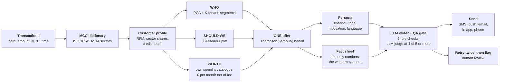
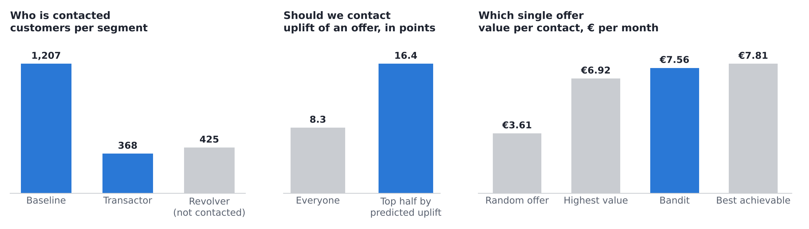

# Card upgrade recommendation engine

Turns raw card transactions into one personal, checked message about a premium card benefit that is
worth real euros to that customer, and stays silent when an offer would do harm.

Proof of concept on the IBM synthetic card dataset: 24.4 million transactions, 2,000 customers.

## Pipeline



| Stage | Module | What it does |
|-------|--------|--------------|
| Ingest | `reco/ingest.py` | Raw CSV to a Parquet warehouse |
| Profile | `reco/features.py` | MCC join, spend sectors, monthly RFM (DuckDB) |
| Who | `reco/segment.py` | PCA + K-Means, k chosen by silhouette, segments named by rule |
| Should we | `reco/uplift.py` | X-Learner CATE on a simulated randomized campaign |
| Worth | `reco/value.py` | Monthly value of every benefit in `reco/benefits.csv` for every customer |
| One offer | `reco/bandit.py` | Linear Thompson Sampling over benefit sectors, evaluated offline |
| Persona | `reco/persona.py` | Synthetic contact persona conditioned on behaviour |
| Message | `messaging/` | LangGraph agent "Claire": write, check, judge, retry twice, else flag |

## Results



- **Who.** Three segments. The 425 revolvers (21%) spend the most but carry the highest credit risk, so they get no offer.
- **Should we.** Estimated and true uplift correlate at 0.75. Contacting only the top half by predicted uplift doubles the effect of an offer.
- **Which offer.** The bandit reaches 97% of the best achievable value per contact and twice that of a random offer.
- **Message.** 25 of 25 messages passed the rule checks and the LLM judge at the first attempt, across 5 channels in English and French.

Campaign response, personas and offer acceptance are simulated, and the transactions are synthetic.
These numbers show that the machinery works, not market lift.

Full detail: [slide deck](reports/slides/slides.pdf), [one pager](reports/one_pager.pdf),
[run notebook](notebooks/report.ipynb).

## Run

Download the Kaggle dataset `ealtman2019/credit-card-transactions` into `data/raw/`:

```bash
uvx kaggle datasets download ealtman2019/credit-card-transactions -p data/raw --unzip
```

Train (CPU, 16 GB RAM or more):

```bash
uv sync
uv run python -m reco ingest
uv run python -m reco train
uv run pytest
```

Generate messages (needs the `train` outputs and `OPENROUTER_API_KEY`, see `.env.example`):

```bash
source .env
uv run python -m messaging --sample 5
```

Outputs land in `data/` (override with `RECO_DATA`). To run on a cloud pod, see [docs/runpod.md](docs/runpod.md).

## Repository

```
reco/         pipeline, from ingest to offer selection
messaging/    message agent, prompts and checks
tests/        pipeline and messaging tests
notebooks/    executed run report
reports/      slide deck, one pager and full report
docs/         cloud run guide, README figure
```

## Sources

- Data: [IBM synthetic card transactions](https://www.kaggle.com/datasets/ealtman2019/credit-card-transactions), [MCC list](https://github.com/greggles/mcc-codes)
- Methods: [X-Learner](https://www.pnas.org/doi/10.1073/pnas.1804597116) (Künzel et al., 2019), [Linear Thompson Sampling](https://proceedings.mlr.press/v28/agrawal13.html) (Agrawal and Goyal, 2013), [LangGraph](https://github.com/langchain-ai/langgraph)
